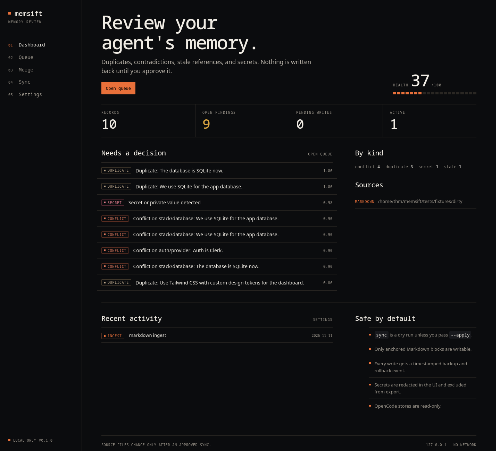

# memsift

[](https://github.com/Arerii7/memsift/actions/workflows/ci.yml)


> Keep coding agent memories tidy, consistent, and under your control.

memsift scans Markdown and explicit OpenCode memories for duplicates,
conflicts, stale references, and possible secrets. Review what it finds, then
choose what to keep. Your index stays local; no account or cloud service needed.

**Find. Review. Decide.** Source files change only after you approve a preview.



## Try it

Requires Python 3.12 or newer and SQLite with FTS5. Tested on Linux and macOS;
Windows is not supported yet.

```bash
git clone https://github.com/Arerii7/memsift.git
cd memsift
python3 -m venv .venv
.venv/bin/pip install -e .
.venv/bin/memsift init --path tests/fixtures/dirty
.venv/bin/memsift scan
.venv/bin/memsift doctor
.venv/bin/memsift review
```

The sample uses a **synthetic** key to demonstrate secret redaction. `review`
opens a local interface at `http://127.0.0.1:8787`; stop it with `Ctrl+C`.

> **Preview:** Try memsift on a copy of your files first and review every diff.

> **Security:** memsift is a local, single-user tool. The review UI binds to
> loopback and has no authentication; never expose it to a network. The local
> index and backups can contain sensitive source content. See
> [SECURITY.md](SECURITY.md) for the threat model and reporting process.

To inspect another directory, use `.venv/bin/memsift scan --path /path/to/notes`.
This also registers that path for future scans; add `--no-save` to scan it once.
Run `.venv/bin/memsift --help` to see all commands.

## What it checks

- Duplicate and similar records, and possible conflicts about the same topic.
- References to missing files, missing sources, and optionally expired records.
- Common patterns that look like credentials or private keys.
- `npm run` scripts in `AGENTS.md` and `CLAUDE.md` that are missing from the
  nearest `package.json`. Commands are inspected, never run.

Findings are suggestions, not facts: a detected conflict may be harmless, and
secret detection cannot guarantee that every credential will be found. Review
results before taking action.

## Explore your sources

```bash
.venv/bin/memsift sources --path /path/to/notes  # files, sizes and skipped folders
.venv/bin/memsift search 'database'             # search the local index
.venv/bin/memsift list                          # list indexed records
.venv/bin/memsift show RECORD_ID                # inspect a record and its history
```

Markdown discovery includes `MEMORY.md`, `AGENTS.md`, `CLAUDE.md`,
`.opencode/memory/**/*.md` and other Markdown files in the chosen directory.
Most hidden directories are skipped; `sources` shows what was found and which
hidden directories were skipped. It does not determine which files an agent
actually loads.

OpenCode import is read-only and looks for explicit `remember:`, `decision:`,
`preference:` and fenced `memory` entries:

```bash
.venv/bin/memsift import opencode --project /path/to/project
```

Use `--db /path/to/opencode.db` to choose a different OpenCode database.

## Review and write changes

Archiving, merging or editing a record in memsift does not immediately change
the source file. `sync` first shows a preview; source writes require `--apply`.
Only Markdown blocks with matching memsift anchors can be changed:

```md
<!-- memsift:id=ms_example -->
- We use SQLite.
<!-- /memsift:id=ms_example -->
```

To preview anchors for a file or directory, then add them explicitly:

```bash
.venv/bin/memsift anchor --path /path/to/notes
.venv/bin/memsift anchor --path /path/to/notes --apply
```

Adding anchors changes source files and creates backups. Review the preview
before applying. After reviewing records and approving changes:

```bash
.venv/bin/memsift sync          # preview
.venv/bin/memsift sync --apply  # confirm and write
.venv/bin/memsift history       # find the sync event ID
.venv/bin/memsift rollback EVENT_ID
```

memsift creates backups under `~/.local/share/memsift/backups/` by default;
`MEMSIFT_HOME` changes the storage location. Rollback refuses to overwrite a
file changed after sync or discard newer pending edits. Older sync events that
lack a post-sync hash cannot be rolled back automatically; their backups are
still available in the recorded backup directory.

Only anchored Markdown is writable. OpenCode's database is opened read-only and
is never modified. The local index and backups can contain sensitive source
content; redaction applies to displayed output and exports, not to the stored
source data. Keep the storage directory private.

If identical unanchored records are removed, their identities can be ambiguous.
memsift keeps previous decisions separate and asks you to add unique anchors and
review them manually.

## Development

```bash
.venv/bin/pip install -e '.[dev]'
.venv/bin/ruff check .
.venv/bin/pytest --cov=src/memsift --cov-report=term-missing
```

Tests use local fixtures and should not make network requests. CI runs the suite
on Python 3.12–3.14 for Linux and on Python 3.12 for macOS. See
[CONTRIBUTING.md](CONTRIBUTING.md) for a short guide.

## Changelog

See [CHANGELOG.md](CHANGELOG.md).

## License

[MIT](LICENSE)
